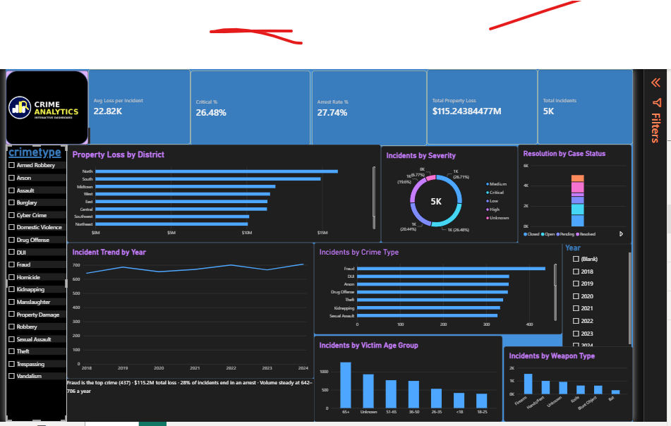

# SWYNEX Final Data Analytics Project: Crime Data Case Study

**Author:** Farhana Ashraf Ganaie
**Internship:** Data Analyst Intern, SWYNEX Technologies (Data & AI)
**Tools used:** Excel (Power Query), MySQL Workbench, Power BI, DAX, GitHub

This is the final project of my SWYNEX internship. It brings together everything from the earlier tasks: cleaning the data, exploring it with SQL, building an interactive dashboard, and turning the results into business insights.

---

## 1. Problem Statement

Crime records are only useful when someone can read them quickly and act on them. In this project I wanted to answer a few simple questions for a decision-maker such as a police department or a city planner:

- Is crime going up or down over time?
- Which types of crime happen most often?
- Which areas are the busiest?
- How much property loss is involved, and how often do cases end in an arrest?

## 2. Dataset Information

The dataset is a public crime dataset, cleaned in Task 1.

- **Size:** 5,050 incidents recorded between 2018 and 2024
- **Fields:** crime type, district, severity, case status, resolution, weapon used, victim age group, property loss and number of arrests
- **Privacy:** personal identifiers were removed before analysis

## 3. Data Cleaning (Task 1)

I cleaned the data in Excel using Power Query. The main steps were:

1. Checked every column for missing values, duplicate rows, wrong data types and inconsistent entries.
2. Removed duplicates and fixed data types, especially dates and numbers.
3. Standardised text values so the same category was always written the same way.
4. Removed personal identifiers.
5. Saved the result as a clean CSV file for the next stages.

Some gaps could not be filled honestly, so I left them as they were instead of guessing. 329 incidents have no date and 414 have no property loss value. These are left out of the yearly trend and the loss statistics only, and stay in every other count.

## 4. Exploratory Data Analysis (Task 2)

I loaded the cleaned data into a MySQL table called `crime` and ran SQL queries using COUNT, AVG, MIN, MAX, GROUP BY and ORDER BY. I then used Excel to chart the results.

**Key numbers**

| Measure | Value |
|---|---|
| Total incidents | 5,050 |
| Incidents with a recorded property loss | 4,636 |
| Average property loss | $24,858 |
| Smallest / largest loss | $20.66 / $49,998.30 |
| Average arrests per incident | 2.46 |

## 5. Dashboard (Task 3)

I built an interactive Power BI dashboard on the same dataset, using DAX measures for the KPIs.

- **KPI cards:** total incidents, total property loss, arrest rate, percentage of critical cases and average loss
- **Charts:** yearly trend, crime types, severity, loss by district, resolution against case status, victim age groups and weapons used
- **Filters:** crime type and year, so anyone can explore the data on their own



## 6. Key Business Insights

1. **Crime is stable, with a slight rise.** Yearly incidents stayed between 642 (2018) and 706 (2024), roughly a 10% increase over seven years, with small dips in 2020 and 2023.
2. **Fraud is the most common crime.** It accounts for 437 incidents, about 8.7% of the total, followed closely by DUI (353), Arson (352) and Drug Offense (350).
3. **North and South are the busiest districts.** Together they make up about 27% of all incidents (696 and 668). Southeast is the quietest with 391, so North sees roughly 78% more incidents than Southeast.
4. **Property loss is large in total but similar across crime types.** Reported losses add up to about $115.2 million, around $22.8K per incident. The average loss only ranges from about $23,500 (Homicide) to $26,500 (Kidnapping), so the type of crime says little about how much is lost.
5. **Arrests are made in only about 28% of incidents.** Even though the average arrest count per incident looks healthy, most cases do not end in an arrest, which points to a gap between reported crime and resolved cases.
6. **A few categories are very small.** Manslaughter (54), Property Damage (48) and Armed Robbery (40) are far smaller than the other types (274 to 437). They may be labels that could be merged or reviewed in a future cleaning round.

## 7. Recommendations

- **Focus patrol and prevention resources on the North and South districts first**, since they carry the most incidents.
- **Run awareness and prevention work against fraud**, because it is the single biggest category.
- **Look into why only about 28% of cases end in an arrest**, for example by comparing resolution rates across crime types and districts.
- **Keep monitoring the yearly trend.** The rise is small, but it is steady enough to be worth watching.
- **Review the very small crime categories** and decide whether they should be merged with related ones.

## 8. Limitations

- 329 incidents have no date, so the yearly trend covers only the incidents that do.
- 414 incidents have no property loss recorded, so loss figures come from 4,636 incidents, not all 5,050.
- The analysis is descriptive. It shows what happened, not why.

## 9. Project Files

```
SWYNEX-Final-Data-Analytics-Project/
├── README.md
├── data/
│   └── crime_data_cleaned.csv
├── sql/
│   ├── load_crime_data.sql
│   └── analysis_queries.sql
├── eda_charts/
│   ├── chart1_crimes_per_year.png
│   ├── chart2_crimes_by_type.png
│   ├── chart3_crimes_by_district.png
│   └── SWYNEX_Task2_Charts.xlsx
└── dashboard/
    ├── SWYNEX-Interactive-Dashboard.pbix
    ├── SWYNEX_crime_dashboard_data.csv
    └── dashboard.png
```

Earlier task repositories:

- Exploratory Data Analysis: https://github.com/ashraffarhana810-maker/SWYNEX-Exploratory-Data-Analysis
- Interactive Dashboard: https://github.com/ashraffarhana810-maker/SWYNEX-Interactive-Dashboard

## 10. Conclusion

This project took raw crime data through the full analytics cycle: cleaning, SQL exploration, an interactive Power BI dashboard, and clear recommendations. The main finding is that crime in this dataset is steady rather than exploding, fraud is the biggest category, North and South need the most attention, and most cases never reach an arrest. Working through every stage myself taught me how much of analytics is careful cleaning and clear communication, not just charts.

---

*Completed as part of the SWYNEX Technologies Data Analyst internship, October 2026.*
